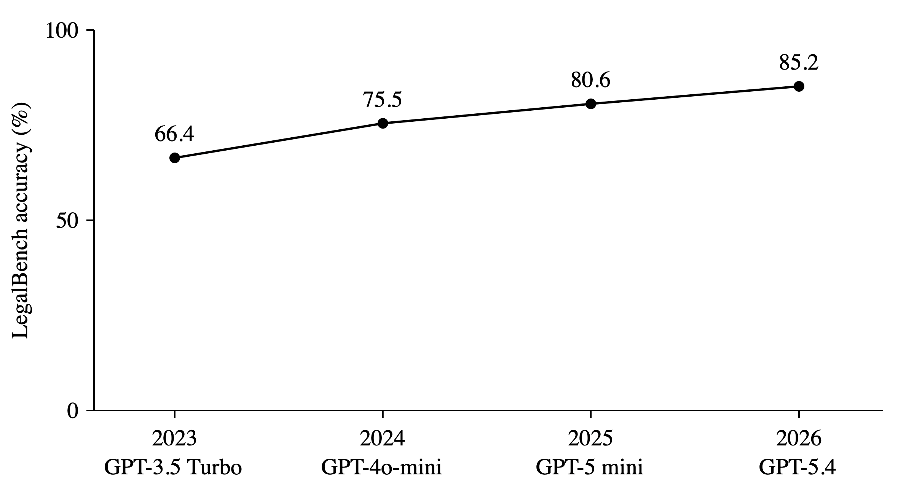

Roughly three years ago, I led the construction of [LegalBench](https://arxiv.org/abs/2308.11462)—a large-scale benchmark for measuring the legal reasoning capabilities of large language models (LLMs). When we released LegalBench, we argued that one of the central challenges for AI research was understanding how to build systems capable of legal reasoning. We're in the midst of building the second iteration of the benchmark ("LegalBench2"), so now is an opportune time to [reflect](https://x.com/OrinKerr/status/1995942092452102342) on the original benchmark—what went well, what went poorly, and what it suggests about the future of legal AI research.

LegalBench was an extraordinary group effort made possible by the incredible patience, commitment, and curiosity of legal scholars, computer science researchers, lawyers, and legal technologists. They all agreed to join this unorthodox research effort led by an unknown computer science JD/PhD student (me), who was fairly convinced the project could do something marginally interesting but had little actual evidence to support his convictions. For a large, collaborative project like LegalBench, I want to emphasize that the criticisms that follow are (1) my own views and (2) about choices that I made.

## What worked?

LegalBench was motivated by the thesis that LLMs would be highly relevant to legal AI and that accordingly, we needed a benchmark with which we could study, track, and better understand LLM performance in the legal domain. On these fronts, I think LegalBench succeeded.

**Research improvements**: We've seen researchers study a wide spectrum of questions on LegalBench. I can't point to a single major technical innovation that LegalBench unlocked. But I would like to believe that LegalBench has enabled many smaller insights which, upon aggregation, amount to something more significant. For example, [DatologyAI and Thomson Reuters](https://www.datologyai.com/blog/thomson-reuters-partners-with-datologyai-to-break-through-the-post-training-ceiling), [Equall.ai](https://arxiv.org/abs/2403.03883), and [NVIDIA](https://developer.nvidia.com/blog/nvidia-nemotron-3-ultra-powers-faster-more-efficient-reasoning-for-long-running-agents/) have all used the benchmark to study questions surrounding domain-specific legal pretraining/midtraining. It has also served as a testbed for research on [AI safety](https://arxiv.org/abs/2310.03693), [synthetic training data](https://arxiv.org/abs/2402.18334), [structured reasoning](https://arxiv.org/abs/2402.10400), [confidence estimation](https://arxiv.org/abs/2601.08134), [model compression](https://arxiv.org/abs/2412.11242), [model routing](https://arxiv.org/abs/2412.04692), and [automated evaluation](https://arxiv.org/abs/2510.07243).

**Comparing different LLMs**: Shortly after LegalBench was released, [Vals.ai](https://www.vals.ai/benchmarks/legal_bench) created a lovely leaderboard tracking the cost and accuracy of different LLMs on LegalBench. They still actively maintain it, and their website has become a useful resource for understanding the cost/quality tradeoffs models exhibit in this domain. Beyond the Vals leaderboard, many folks in industry and practice have told us privately (or [reported](https://www.thomsonreuters.com/en-us/posts/innovation/legal-ai-benchmarking-cocounsel/) publicly) using LegalBench to assess internal models or systems.

**Tracking progress over time**: Finally, I think LegalBench was helpful insofar as it provided the community with an empirical way to track LLM progress in the legal domain over time. Indeed, it's worth pausing to reflect on just how far AI has come on legal tasks:

The initial results on LegalBench in 2023 were fine. Models weren't great, but there was enough "there" to suggest they were clearly capable of doing something. Over the last several years, improvements in scaling, pretraining, reinforcement learning, inference-time compute, and other areas have made a huge difference.

Concrete numbers are important because they have changed how lawyers view the technology. The legal profession is [famously averse](https://scholarship.law.columbia.edu/faculty_scholarship/857/) to forms of measurement that do not involve counting minutes that someone else can be charged for. Whether AI systems were getting better at law is exactly the sort of discussion that might otherwise be colonized by anecdata. Today, commentators often [cite](https://www.lawfaremedia.org/article/an-ai-playground-for-the-courts) LegalBench results as evidence that AI’s steady progress on legal tasks warrants broader discussion of its economic, social, and professional implications.

## What didn't work?

The list of mistakes we made with LegalBench is at least as long—and perhaps more substantial—than the list of successes above.

**We should have been more ambitious.** LegalBench was built in two spurts. The first involved building datasets by hand, between April and June 2022.. The second spurt was the larger collaborative data collection process (between February and April 2023). Throughout this time period, LLM context windows remained fixed at ~4K tokens. For this reason, LegalBench only targeted tasks which could fit within these context windows. In an incredible failure of imagination, I neglected to consider (1) that context windows might eventually expand and (2) that we should build the benchmark accordingly.[^4] As a result, many long context legal tasks—which would have been way too long for 2023 LLMs but would have been appropriate for their successors—were deliberately left out of LegalBench. Not including them was, in retrospect, a lost opportunity.

**We didn't manage the open-contribution model well.** One of my goals was to sustain, after publication, the open-contribution model that had made LegalBench possible.[^1] In the ideal world, LegalBench would have followed a process similar to HELM or [Terminal-Bench](https://www.tbench.ai/), in which new versions are iteratively released. Each version might bring in new contributors and partners, allowing the benchmark to evolve alongside the field.

This turned out to be *much* harder than expected—a point almost painfully obvious in retrospect. Sustaining a "live" benchmark requires individuals who can fully commit to the endeavor. Soliciting new tasks, vetting task contributions, running models, and patching errors all take enormous amounts of time and energy. LegalBench never added tasks after release, and I wish I'd thought more about (or been better at) structuring this.

**I'm not sure how much work LegalBench's proposed reasoning framework does.** LegalBench proposed a taxonomy that organized tasks according to the kinds of legal reasoning they required. The original paper based its taxonomy on "IRAC," which is a framework that first-year law students are instructed in and one that pervades legal writing. Broadly speaking, IRAC says that legal analysis involves (1) spotting the legal **I**ssue, (2) identifying the applicable **R**ule, (3) **A**pplying the rule to the facts at hand, and (4) determining the legal **C**onclusion. LegalBench included two additional categories, corresponding to tasks that required interpreting legal text and tasks that required reasoning about legal rhetoric.

The framework gave the paper a conceptual backbone, and some recent benchmarks have picked it up—most notably micro1's [LegalReasonBench](https://www.micro1.ai/benchmark/legal-reason-bench). But is IRAC actually helpful for legal AI? I'm actually not sure. I'll discuss this more below, but I think there's room for deeper engagement between AI and traditional legal theory/philosophy.

## What does this mean for the future of legal AI?

Three years on from LegalBench—having weighed what worked well and what didn't—I have the following feelings about legal AI today. 

**Legal AI is experiencing a battle for openness.** The frontier labs' pivot towards legal AI has created an arms race in private legal benchmarking. Data vendors are spending hundreds of thousands of dollars (at least) to build benchmarks which, given said construction costs, cannot be distributed for free. There are obvious exceptions,[^2] but the current ecosystem increasingly confines cutting-edge legal AI research to industry, where researchers can afford access to advanced legal benchmarks. There are many interesting legal AI research questions (around pretraining, post-training, and agentic harness design) which we cannot answer because we don't have sufficiently advanced benchmarks to test on.

This state of affairs is ironic for two reasons. First, the legal domain is fully embracing open-source models—just see what firms like [Latham](https://www.ft.com/content/a2aaa848-92c3-4f7a-b758-5858bfb29e70?syn-25a6b1a6=1) and [Kirkland](https://www.artificiallawyer.com/2026/06/01/kirkland-hints-it-could-fine-tune-llms-for-own-legal-ai-model/) have been up to. So while the models are becoming more open, the datasets are becoming more closed. T Second, the shift towards industry locks out the set of entities which, in principle, should be perfect for legal AI research: universities. Legal AI's biggest challenge is that it requires lawyers and computer scientists to work together and develop a deep understanding of each other's disciplines. This is hard because the two communities have historically not communicated well (when at all). If we think that making progress on legal AI requires interdisciplinary conversation and collaboration, then it is logical to think that universities—*which happen to have many computer scientists and lawyers*—should have an important role to play.

The tenuous nature of the open legal AI ecosystem also explains why a benchmark like LegalBench continues to be used. In the year 2026, LegalBench is an **incredibly narrow and limited benchmark**: it does not measure long-form generations, agentic systems, long-context reasoning, or subjective legal quality. It is also basically saturated.[^3] LegalBench's longevity isn't a sign of inherent virtue, but an indictment of the ecosystem's failure to produce superior alternatives.  

**Legal AI needs more institutional coordination.** As I mentioned above, we struggled to execute on LegalBench as a dynamic and evolving live benchmark. We underestimated the coordination overhead, and in retrospect, I didn't fully appreciate the institutional design problems involved. (Once again, I am so so glad the wonderful folks at [Terminal-Bench](https://www.tbench.ai/) are figuring this out.)

I think this challenge extends beyond LegalBench. I increasingly believe that the community needs a consortium, designed to promote basic research on legal AI (something I've previously [written](https://www.pnas.org/doi/10.1073/pnas.2509757122) about). We need to recognize that legal AI is both technically and institutionally a harder problem than other domains that AI has recently tackled (like coding, math, or science). Data confidentiality is harder. Understanding quality is harder. There aren't clear downstream metrics we can optimize. A consortium could serve several important functions: coordinating evaluations, maintaining benchmarks, and facilitating knowledge transfer among educators, researchers, practicing lawyers, and their employers.

As a current law professor I'm likely biased, but I think there's a deeply important relationship between legal education and legal AI research. The goal of legal AI evaluation is to measure whether legal AI systems are producing good or bad outputs. The goal of legal education is to train students to recognize the difference between good and bad legal work. If legal AI evaluation and legal education are approaching their respective tasks with fundamentally different understandings of legal work, then something is deeply broken.

**What can legal reasoning teach us about AI?** Finally, I think we've strayed from the original aspiration of legal AI: the hope that studying law might teach us something about AI itself.

To understand the history of AI is to recognize computer science as a roving caravan of researchers. Over the last seventy-five years, this caravan has stopped at different camps of experts. At each camp, our nomad computer scientists have disembarked, studied how the local residents reasoned about the world, and sought to build computational systems capable of replicating their way of thinking. Sometimes they would succeed. Other times they would be wiped out by a brutal [winter](https://www.historyofdatascience.com/ai-winter-the-highs-and-lows-of-artificial-intelligence/). But each visit would teach them something deeper about building computational intelligence, allowing them to push the field of computer science in a more fundamental way. Through this multi-generational journey, computer science has learned from chess grandmasters, logicians, mathematicians, cognitive psychologists, linguists, and programmers. The most recent stop on this expedition has been the camp of the lawyers. Their visit here has provoked the question: can AI systems do "legal reasoning?" This was the question behind the original LegalBench paper and the literature that predated LegalBench.

There are two ways to understand legal reasoning. The first is professional: legal reasoning is what lawyers do. The second is intellectual: legal reasoning is a particular way of thinking about the world—a sort of algebra in its own right that operates in the fuzzy realm of natural language that mathematics long ago ceded. Modern legal AI benchmarking—driven by AI's preoccupation with [automating work](https://newsletter.semianalysis.com/p/gdpx-measuring-frontier-model-capabilities?redirect=app-store-no-desktop&inbox=true&triedRedirect=true)—focuses on the first category. To be clear, it makes sense why legal AI benchmarking has gone down this route. The economy is [important](https://en.wikipedia.org/wiki/It%27s_the_economy,_stupid). Asking whether AI can perform valuable legal work is exactly what you should be asking if you're spending billions on training models.

But I am an academic, and to be an academic in the year 2026 is to be a romantic. Which means I mourn the professionalization of legal benchmarking and the departure from its original philosophical roots. What we lose when we focus on legal reasoning from a professional standpoint is the opportunity to examine legal reasoning from a computational standpoint. Deep down, I believe that studying whether AI systems can perform legal reasoning might teach us something about legal reasoning itself. Maybe, perhaps heretically, I tend to believe that there are rich connections to be drawn between legal theory and statistical machine learning.

 
> As I mentioned in the beginning, these ideas are top-of-mind because we're currently building LegalBench2. I'll write more about LegalBench2 in a separate post, but if you're interested in contributing/participating — do reach out! 

[^1]: LegalBench solicited many tasks prior to release/publication, and I think we did *that* well. But the post-release maintenance left something to be desired. 

[^2]: In particular, shout-out to Harvey for open-sourcing [LAB](https://www.harvey.ai/blog/introducing-harveys-legal-agent-benchmark), and to Crosby for open-sourcing [RedlineBench](https://github.com/crosbylegal/redline-bench). And to Snorkel, for their [Open Benchmarks Grants](https://benchmarks.snorkel.ai/) program.

[^3]: Moreover, LegalBench today is very close to being saturated (if it isn't already). As of this writing, the best model on LegalBench is Fable 5, which scores 88.56% ([source](https://www.vals.ai/benchmarks/legal_bench)). Maybe there are a few points on LegalBench left for frontier models to squeeze out. But I'm not sure if those points are meaningful, in either an economic or academic sense.

[^4]: This is made all the more embarrassing by the fact that some of my [closest friends and colleagues](https://hazyresearch.stanford.edu/blog/2023-03-27-long-learning) played an important role in enabling larger context windows. Oops.
